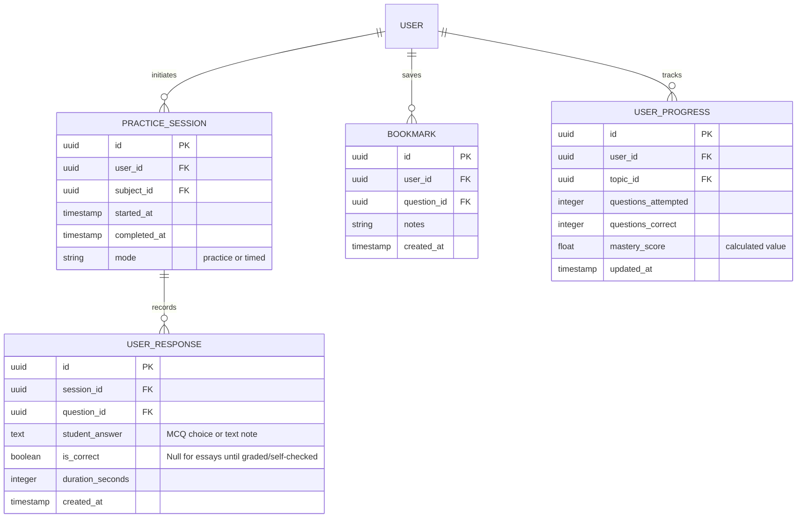
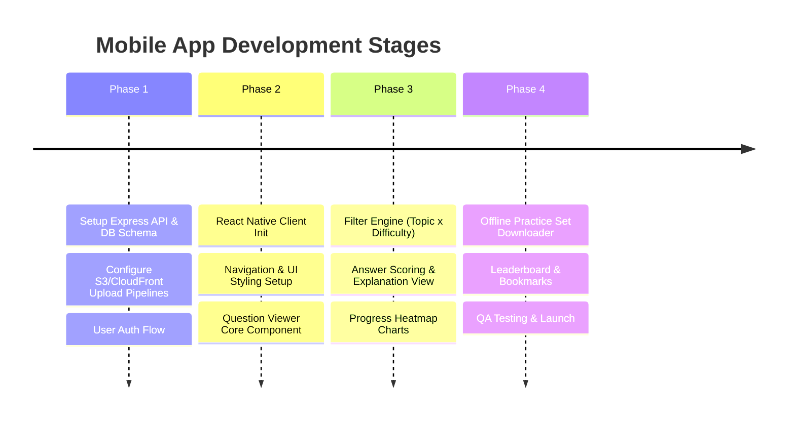

# EdGenie — User-Facing Mobile Application & API Implementation Plan

> **Version**: 1.0.0
> **Last Updated**: 2026-08-16
> **Status**: Proposed — Ready for Review

This document outlines the user-facing mobile application and API for **EdGenie**, the platform enabling O/A Level students to practice past papers selectively (specifically targetting rare-hard syllabus topics).

---

## 1. Product Features (Student & School View)

EdGenie is a B2B platform distributed through colleges to students. The primary user interface is a mobile application for students to practice questions, track progress, and target their preparation.

### 1.1 Core Features
1. **Topic-Targeted Practice (Topic × Difficulty × Frequency)**:
   - Students select a subject, then filter questions by syllabus topics, difficulty levels (`easy`, `medium`, `hard`, `expert`), and topic frequency (`high`, `medium`, `low`).
   - Enables students to isolate the **rare-hard** questions that traditionally block top grades (e.g., Grade A/A*).
2. **Interactive Practice Mode**:
   - **MCQ Mode**: Interactive radio buttons, instant scoring feedback, and structured mark scheme explanation retrieval.
   - **Essay Mode**: Displays the question + sub-parts, allows students to type notes or upload a photo of handwritten work, and reveals structured marking schemes, insert texts, and examiner reports side-by-side.
3. **Syllabus & Progress Analytics**:
   - Interactive visual syllabus showing mastery metrics per topic (e.g., "Circular Motion: 3/5 Hard Questions Correct").
   - Frequency-difficulty heatmaps highlighting topic distribution in past CAIE papers.
4. **Saved Questions & Bookmarking**:
   - Save specific questions for review or revision before exams.
   - Tag bookmarked questions with custom categories (e.g., "Trick Question", "Complex Formula").
5. **Leaderboard & School Competition (Engagement)**:
   - Weekly XP-based or question-completed leaderboard restricted to the student's college or class.
   - Peer benchmarking to boost engagement.
6. **Offline Support & Syncing**:
   - Pre-download a "practice set" (JSON data + cached images) for offline use (e.g., during transit or study sessions without internet access).
   - Sync practice history when back online.

---

## 2. Tech Stack

```
┌─────────────────────────────────────────────────────────┐
│                    Mobile Client                        │
│             React Native (Expo, TypeScript)             │
│   Native Wind (Tailwind) / React Native Paper (UI)      │
└────────────────────────────┬────────────────────────────┘
                             │ HTTPS / WSS
                             ▼
┌─────────────────────────────────────────────────────────┐
│                    API Gateway / Backend                │
│                Express.js (Node.js, TypeScript)         │
│             Prisma ORM / pg / JSON Web Tokens           │
└──────────────┬────────────────────────────┬─────────────┘
               │ Read Shared DB             │ Upload/Fetch Visuals
               ▼                            ▼
┌──────────────────────────────┐    ┌─────────────────────┐
│    PostgreSQL + pgvector     │    │   Amazon S3 +       │
│  (Shared with admin pipeline)│    │   CloudFront CDN    │
└──────────────────────────────┘    └─────────────────────┘
```

### 2.1 Frontend (Mobile App)
- **Framework**: React Native with **Expo** (allows fast iteration, OTA updates, and simple multi-platform packaging for iOS and Android).
- **State Management**: **TanStack Query** (React Query) for API caching/syncing; **Zustand** for lightweight local state (session, authentication tokens).
- **Navigation**: **Expo Router** (file-based navigation matching modern web apps).
- **UI Components**: **React Native Paper** (Material Design) or custom components styled via **NativeWind** (Tailwind for React Native).
- **Visual Rendering**: `react-native-svg` for rendering SVGs (if syllabus/vector graphics are used), and fast image components like `expo-image` (includes memory caching, progressive loading, and blurhash support).

### 2.2 Backend API (User Side)
- **Framework**: **Express.js** with TypeScript (lightweight, modular, highly concurrent Node.js runtime).
- **Database Access**: **Prisma ORM** or **Kysely** (type-safe SQL builder) accessing the PostgreSQL database.
- **Authentication**: JWT-based session management, securely signing tokens on client login.
- **Caching**: **Redis** for storing fast syllabus hierarchies, user leaderboards, and session caches to reduce direct DB loads.

---

## 3. Database & Visual Asset Management

The database is shared with the Admin pipeline (which populates the CAIE past papers, questions, answers, and visual assets).

### 3.1 DB Layout for User Data
In addition to the tables populated by the admin side, the user-facing API introduces the following schema extensions:



### 3.2 Visual Asset Maintenance
Images extracted from past papers during Stage 3 (graphs, diagrams, tables) must be loaded efficiently on mobile screens.

1. **Storage Pipeline**:
   - The Stage 3 pipeline uploads cropped visual assets to an **Amazon S3** bucket.
   - S3 organizes files by: `assets/subjects/{subject_code}/{year}/{session}/qp_{paper_number}/{visual_id}.png`.
2. **CDN Delivery**:
   - S3 is shielded behind **Amazon CloudFront** CDN to ensure low-latency delivery across geographical regions.
   - CloudFront handles image optimization and caching.
3. **Database Records**:
   - The `VISUAL` table stores the `storage_url` pointing to the CDN endpoint (e.g., `https://cdn.edgenie.com/assets/...`).
   - It also stores visual metadata: `width`, `height`, and a `blurhash` string (stored in the JSON `metadata` column) generated during pipeline extraction.
4. **Mobile App Image Loading Strategy**:
   - **`expo-image` Integration**: The app uses `expo-image` to load URLs.
   - **Placeholder Rendering**: While loading, it displays the `blurhash` preview so the UI does not suffer from sudden layout shifts.
   - **Disk Caching**: Images are cached on the local device storage automatically so they do not consume bandwidth on subsequent views.

---

## 4. REST API Endpoints

All endpoints are prefix-grouped under `/api/v1` and require authorization headers (`Authorization: Bearer <token>`).

### 4.1 Authentication & Enrollment
* **POST `/auth/login`**
  - Payload: `{ "email": "student@college.edu", "password": "secure_password" }`
  - Returns: `{ "token": "JWT_TOKEN", "user": { "id": "...", "name": "...", "college_id": "..." } }`
* **POST `/auth/register-student`**
  - Payload: `{ "email": "...", "password": "...", "license_key": "COLLEGE_LICENSE_KEY" }`
  - Returns: JWT Token & verification status.

### 4.2 Syllabus & Filter Metadata
* **GET `/subjects`**
  - Returns: List of subjects the student's college is subscribed to.
* **GET `/subjects/:subjectId/syllabus`**
  - Returns: Full hierarchical syllabus tree (`SYLLABUS_TOPIC` items joined by unit and topic numbers) along with frequency metrics.
  ```json
  [
    {
      "id": "topic-uuid",
      "unit_number": "1",
      "unit_name": "Financial Accounting",
      "topic_number": "1.2",
      "topic_name": "Source Documents",
      "frequency_total": 45,
      "frequency_by_year": { "2023": 4, "2022": 6 }
    }
  ]
  ```

### 4.3 Practice & Questions Engine
* **POST `/practice/generate-set`**
  - Payload:
    ```json
    {
      "subject_id": "uuid",
      "topic_ids": ["uuid-1", "uuid-2"],
      "difficulty_levels": ["hard", "expert"],
      "limit": 10
    }
    ```
  - Returns: A customized array of questions with parts, marking schemes, and visual assets included.
  ```json
  {
    "session_id": "session-uuid",
    "questions": [
      {
        "id": "question-uuid",
        "question_number": "Q3a",
        "question_text": "Calculate the ledger balance of...",
        "marks": 5,
        "difficulty_label": "hard",
        "visuals": [
          {
            "id": "visual-uuid",
            "category": "table",
            "storage_url": "https://cdn.edgenie.com/...",
            "width": 600,
            "height": 300,
            "metadata": { "blurhash": "LEHV6nWB2yk8X=ofv|aef#j[fQj[" }
          }
        ],
        "parts": [
          { "part_label": "i", "part_text": "Detail the entry...", "marks": 2 }
        ]
      }
    ]
  }
  ```
* **POST `/practice/session/:sessionId/submit`**
  - Payload:
    ```json
    {
      "responses": [
        {
          "question_id": "uuid",
          "student_answer": "Option A",
          "duration_seconds": 45,
          "is_correct": true
        }
      ]
    }
    ```
  - Returns: Updates session status and updates global `USER_PROGRESS` statistics.

### 4.4 Bookmarks & History
* **GET `/bookmarks`** - Returns bookmarked questions.
* **POST `/bookmarks`** - Bookmark a question: `{ "question_id": "uuid", "notes": "..." }`.
* **DELETE `/bookmarks/:questionId`** - Remove bookmark.
* **GET `/leaderboard?subject_id=uuid`** - Returns the leader rank of peers in the same college.

---

## 5. Deployment Architecture & Costs

### 5.1 Architecture Setup
To balance low costs during initial growth with scale potential, we recommend a mix of Serverless and PaaS platforms.

1. **Backend Service (Express API)**:
   - **Platform**: Render.com or Railway.app (simple container hosting, auto-scaling) or AWS ECS Fargate if scaling requirements are strictly corporate.
   - **Database**: Supabase PostgreSQL + pgvector (fully managed database, auto-scaling compute, built-in connection pooler).
2. **Visual Storage**:
   - **Platform**: AWS S3 for object storage + AWS CloudFront CDN for global delivery.
3. **Frontend App (React Native)**:
   - **Build Platform**: Expo Application Services (EAS) for compiling native binaries (IPA/APK) and hosting OTA JS bundles.

### 5.2 Estimated Monthly Cost Breakdown (First 5,000 active students)

| Service | Choice/Tier | Est. Monthly Cost | Reason |
|---------|-------------|-------------------|--------|
| **Backend API** | Render Web Service (Starter) | $15.00 | 512 MB RAM, 1 shared CPU. Sufficient for API concurrency under node clustering. |
| **PostgreSQL Database** | Supabase Pro Tier | $25.00 | Handles vectors, backups, connection pooling, up to 8GB storage out-of-the-box. |
| **Asset Storage (S3)** | AWS S3 Standard (100GB) | $2.30 | $0.023 per GB. Past paper crops are highly compressed, total storage will be low. |
| **Content Delivery (CDN)** | AWS CloudFront | $5.00 | Charges based on egress bandwidth (approx. $0.08/GB). Assuming 60GB download traffic. |
| **Auth & Users** | Supabase Auth (Free Tier) | $0.00 | Free up to 50,000 monthly active users. |
| **EAS Build & Updates** | Expo EAS (Free / Pay-as-you-go) | $0.00 - $29.00 | Standard developer limits are free. |
| **Total Estimate** | | **~$47.30 - $76.30 / mo** | Very cost-effective and scalable B2B architecture. |

---

## 6. Development Phased Roadmap



### Phase 1: Foundation
- Configure the Express server to use Prisma and interface with the shared PostgreSQL instance.
- Establish schema models for `PRACTICE_SESSION`, `USER_RESPONSE`, and `USER_PROGRESS`.
- Build the token validation logic and S3 proxy endpoints for assets.

### Phase 2: Interface Build
- Setup the Expo project and add Tailwind-based styles via NativeWind.
- Build a generic paper parser layout that can render text questions and dynamically fetch S3 visual graphics with blurhash.

### Phase 3: Score Engine & Analytics
- Program local client state logic for MCQs and self-marking check cards for essays.
- Interface with the analytical database view of topics to present completion badges to students.

### Phase 4: Production prep
- Conduct test uploads and mock API load runs.
- Compile packages using EAS and test on testflight/google internal tracks.
